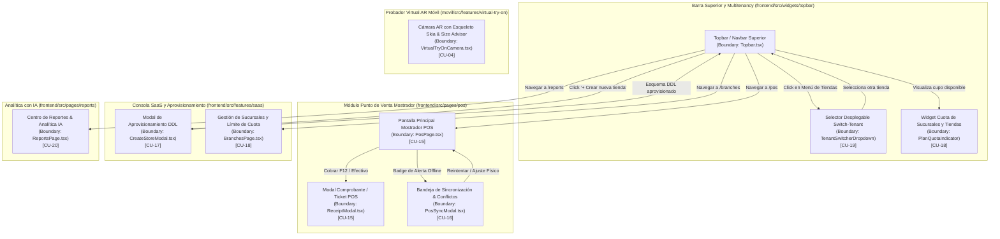

# 3.2.6. DISEÑO DE INTERFACES DE USUARIO (ICONIX PROCESS)

> **Proyecto:** FashionStore — Plataforma Omnicanal SaaS Multitenant  
> **Metodología:** ICONIX Process (Análisis Conducido por Casos de Uso y Prototipos de Interfaz)  
> **Stack de Interfaz Web:** React 18, TypeScript, Tailwind CSS, Lucide Icons, Recharts, Dexie.js (Offline PWA)  
> **Stack de Interfaz Móvil:** React Native, Expo Router, Shopify Skia, MediaPipe / TFLite (Probador Virtual AR)  
> **Trazabilidad de Código:** Extraído directamente de los componentes de `frontend/src/` y `movil/src/`  

---

## 1. FUNDAMENTACIÓN METODOLÓGICA SEGÚN ICONIX

En la metodología **ICONIX Process** (*Doug Rosenberg & Matt Stephens, "Use Case Driven Object Modeling with UML"*), la interfaz de usuario no es una ilustración decorativa posterior, sino el pilar de la fase de análisis y diseño preliminar:
> *"GUI prototypes and use case text drive each other."*

Durante el **Análisis de Robustez**, cada pantalla, formulario, ventana emergente o modal representa un **Objeto Frontera (`Boundary Object`)**, el cual actúa como intermediario entre el actor humano y los controladores de negocio (`Control Objects`).

A continuación se presentan las **Plantillas de Diseño (UI Mockups)** de alta fidelidad, correspondientes punto por punto a los componentes reales implementados en el código fuente de **FashionStore**.

---

## 2. MAPA DE NAVEGACIÓN GLOBAL Y FLUJO DE PANTALLAS (SCREEN FLOW)



---

## 3. CATÁLOGO DE OBJETOS FRONTERA (BOUNDARY OBJECTS)

| ID | Pantalla / Boundary Object | Archivo Fuente en el Proyecto | Caso de Uso | Actores Primarios |
| :--- | :--- | :--- | :--- | :--- |
| **IU-15** | `PosPage` (Punto de Venta) | `frontend/src/pages/pos/PosPage.tsx` | **CU-15** | Cajero / Empleado de Mostrador |
| **IU-15.1** | `ReceiptModal` (Ticket de Venta) | `frontend/src/features/pos/ui/ReceiptModal.tsx` | **CU-15** | Cajero / Cliente |
| **IU-16** | `PosSyncModal` (Bandeja Conflictos) | `frontend/src/features/pos/ui/PosSyncModal.tsx` | **CU-16** | Store Manager / Cajero |
| **IU-17** | `CreateStoreModal` (Nueva Tienda) | `frontend/src/features/saas/ui/CreateStoreModal.tsx` | **CU-17** | Superadministrador / Dueño |
| **IU-18** | `PlanQuotaBadge` / `BranchesPage` | `frontend/src/widgets/topbar/Topbar.tsx` | **CU-18** | Administrador de Tienda |
| **IU-19** | `TenantSwitcherDropdown` | `frontend/src/widgets/topbar/Topbar.tsx` | **CU-19** | Propietario / Staff Multitienda |
| **IU-20** | `ReportsPage` (Analítica IA) | `frontend/src/pages/reports/ReportsPage.tsx` | **CU-20** | Gerente General / Administrador |
| **IU-04** | `VirtualTryOnCamera` (AR Móvil) | `movil/src/features/virtual-try-on/VirtualTryOnCamera.tsx`| **CU-04** | Cliente Final (App Móvil) |

---

## 4. ESPECIFICACIÓN DETALLADA DE PLANTILLAS DE INTERFAZ (UI MOCKUPS)

---

### PLANTILLA IU-15: PUNTO DE VENTA MOSTRADOR (POS) CON SOPORTE OFFLINE

* **Objeto Frontera:** `PosPage`
* **Archivo Fuente:** [`frontend/src/pages/pos/PosPage.tsx`](file:///c:/Parcial-si2/frontend/src/pages/pos/PosPage.tsx)
* **Caso de Uso Vinculado:** **CU-15: Registrar venta de contado offline**
* **Descripción de la Interfaz:**  
  Diseñada para terminales de caja rápida (pantallas táctiles y atajos de teclado). Cuenta con selector de sucursal activa, barra de búsqueda reactiva por texto o escáner de código de barras (SKU), catálogo visual en tarjeta con stock en vivo (almacenado localmente en `offlineDb.kvCache`), panel lateral de ticket actual con cálculo reactivo de subtotal, descuento, monto recibido y vuelto en efectivo. Además, renderiza el indicador de conectividad `OfflineBadge` (`MODO OFFLINE` / `ONLINE`) y botón de instalación PWA.

#### Plantilla Visual (Mockup UI):
```
┌────────────────────────────────────────────────────────────────────────────────────────────────────────┐
│ [🛍️ Boutique Paris]  Sucursal Activa: [ Sucursal Centro ▼ ]    [🔴 MODO OFFLINE]  [📲 Instalar App]    │
├──────────────────────────────────────────────────────┬─────────────────────────────────────────────────┤
│ CATÁLOGO DE PRENDAS & SCANNER                        │ TICKET DE CAJA (#OFF-928371)                    │
│                                                      │                                                 │
│ [ 🔍 Buscar prenda por nombre o código... ] [📷 Scan] │ Prenda             Cant.   P.Unit.    Subtotal  │
│ ┌──────────────────────────────────────────────────┐ │ ─────────────────────────────────────────────── │
│ │ ┌────────────┐  Camisa Lino Premium              │ │ Camisa Lino (M)     [-] 1 [+]  $45.00    $45.00 │
│ │ │ [IMG MINI] │  SKU: CAM-LIN-001 | Color: Blanco │ │ SKU: CAM-LIN-001                       [🗑️]   │
│ │ └────────────┘  Talla: M | Stock: 8 unidades     │ │ ─────────────────────────────────────────────── │
│ │                 Precio: $45.00     [ + Agregar ] │ │ Jean Slim Fit (32)  [-] 2 [+]  $60.00   $120.00 │
│ ├──────────────────────────────────────────────────┤ │ SKU: JEA-SLI-032                       [🗑️]   │
│ │ ┌────────────┐  Vestido Seda Floral              │ │ ─────────────────────────────────────────────── │
│ │ │ [IMG MINI] │  SKU: VES-SED-002 | Color: Rojo   │ │                                                 │
│ │ └────────────┘  Talla: S | Stock: 2 unidades     │ │ Subtotal:                               $165.00 │
│ │                 Precio: $85.00     [ + Agregar ] │ │ Descuento:                                $0.00 │
│ ├──────────────────────────────────────────────────┤ │ TOTAL A PAGAR:                          $165.00 │
│ │ ┌────────────┐  Chaqueta Cuero Biker             │ │                                                 │
│ │ │ [IMG MINI] │  SKU: CHA-CUE-004 | Color: Negro  │ │ Método de Pago:                                 │
│ │ └────────────┘  Talla: L | Stock: 5 unidades     │ │ [💵 EFECTIVO (Activo)]   [💳 TARJETA]   [📱 QR] │
│ │                 Precio: $120.00    [ + Agregar ] │ │                                                 │
│ └──────────────────────────────────────────────────┘ │ Importe Recibido:  [ $200.00                 ]  │
│                                                      │ CAMBIO / VUELTO:   $35.00                       │
│ Atajos: [F2] Buscar SKU  |  [F12] Cobrar Ticket      │ [ ❌ Cancelar Ticket ]   [ ⚡ COBRAR (F12) ]    │
└──────────────────────────────────────────────────────┴─────────────────────────────────────────────────┘
```

#### Controles y Comportamiento Dinámico:
1. **Cálculo Reactivo de Cambio en Efectivo:**
   $$\text{Vuelto} = \max(0, \text{Monto Recibido} - \text{Total})$$
   *Si $\text{Monto Recibido} < \text{Total}$, el botón "COBRAR" se desactiva con estilo atenuado.*
2. **Generación de Clave de Idempotencia:** Se genera `crypto.randomUUID()` al pulsar cobrar.
3. **Persistencia Optimista en IndexedDB:** Escribe la transacción en `offlineDb.orders` con prefijo `OFF-` y decrementa el saldo disponible en caché local inmediatamente para prevenir sobreventa física.

---

### PLANTILLA IU-15.1: COMPROBANTE DE VENTA Y TICKET FACTURA POS

* **Objeto Frontera:** `ReceiptModal`
* **Archivo Fuente:** [`frontend/src/features/pos/ui/ReceiptModal.tsx`](file:///c:/Parcial-si2/frontend/src/features/pos/ui/ReceiptModal.tsx)
* **Caso de Uso Vinculado:** **CU-15: Registrar venta de contado offline**
* **Descripción de la Interfaz:**  
  Modal emergente que renderiza el comprobante fiscal en formato ticket térmico monocromático tipografía monoespaciada, con monograma institucional, razón social del tenant, NIT, detalle de prendas, desglose impositivo y botón de impresión directa hacia impresora de tickets vía `window.print()`.

#### Plantilla Visual (Mockup UI):
```
┌────────────────────────────────────────────────────────┐
│  Comprobante de Venta (POS)               [ ✕ Cerrar ] │
│  Ticket de venta generado e inventario descontado      │
├────────────────────────────────────────────────────────┤
│  ┌──────────────────────────────────────────────────┐  │
│  │                     [ BP ]                       │  │
│  │                BOUTIQUE PARÍS                    │  │
│  │               Sucursal Centro                    │  │
│  │          NIT: 1029384756 • Factura POS           │  │
│  │ ──────────────────────────────────────────────── │  │
│  │ N° Pedido: OFF-928371                            │  │
│  │ Fecha: 07/11/2026 15:42                          │  │
│  │ Canal: IN_STORE (Presencial)                     │  │
│  │ Pago: EFECTIVO (CASH)                            │  │
│  │ ──────────────────────────────────────────────── │  │
│  │ Cant.  Detalle                 P.Unit   Subtotal │  │
│  │ 1x     Camisa Lino (M)         $45.00     $45.00 │  │
│  │ 2x     Jean Slim Fit (32)      $60.00    $120.00 │  │
│  │ ──────────────────────────────────────────────── │  │
│  │ TOTAL PAGADO:                            $165.00 │  │
│  │ Recibido:                                $200.00 │  │
│  │ Cambio / Vuelto:                          $35.00 │  │
│  │ ──────────────────────────────────────────────── │  │
│  │        ¡Gracias por su compra en Boutique París! │  │
│  │   Este documento acredita su compra en caja.     │  │
│  └──────────────────────────────────────────────────┘  │
│                                                        │
│  [ Cerrar ]                          [ 🖨️ Imprimir Ticket ]│
└────────────────────────────────────────────────────────┘
```

---

### PLANTILLA IU-16: BANDEJA DE SINCRONIZACIÓN Y CONCILIACIÓN SERVER-WINS

* **Objeto Frontera:** `PosSyncModal`
* **Archivo Fuente:** [`frontend/src/features/pos/ui/PosSyncModal.tsx`](file:///c:/Parcial-si2/frontend/src/features/pos/ui/PosSyncModal.tsx)
* **Caso de Uso Vinculado:** **CU-16: Conciliar conflictos de inventario offline**
* **Descripción de la Interfaz:**  
  Modal auditor para el Store Manager o Cajero. Informa el estado de la cola outbox local (`pendingCount`) y las transacciones rechazadas por la regla **Server-Wins** (`failedCount`) cuando el stock físico vendido offline ya había sido consumido en línea. Ofrece acciones directas para forzar ajuste en Kardex o anular la venta con devolución de efectivo.

#### Plantilla Visual (Mockup UI):
```
┌────────────────────────────────────────────────────────────────────────────────────────┐
│  🔄  Bandeja de Sincronización & Conflictos                 [🔴 1 conflicto] [ ✕ ]    │
│  Estado de la cola Outbox local y transacciones encoladas en este terminal            │
├────────────────────────────────────────────────────────────────────────────────────────┤
│  ┌────────────────────────┐  ┌────────────────────────┐  ┌───────────────────────────┐ │
│  │ ⏱️ Pendientes           │  │ ⚠️ Rechazados (ACID)   │  │ Acción Manual             │ │
│  │ 0 transacciones        │  │ 1 venta rechazada      │  │ [ 🔁 Sincronizar ahora ]  │ │
│  └────────────────────────┘  └────────────────────────┘  └───────────────────────────┘ │
│                                                                                        │
│  ⚠️ VENTAS CON CONFLICTO DE NEGOCIO (SERVER WINS)                                     │
│  ┌──────────────────────────────────────────────────────────────────────────────────┐  │
│  │ 🛍️ Venta Mostrador Rechazada                      [ RECHAZADO POR SERVIDOR ]      │  │
│  │ ID Clave: 9b1deb4d-3b7d-4b... | Ticket: OFF-928371                               │  │
│  │                                                                                  │  │
│  │ ┌──────────────────────────────────────────────────────────────────────────────┐ │  │
│  │ │ Motivo del rechazo:                                                          │ │  │
│  │ │ Stock insuficiente en la nube. Otra caja o cliente en línea compró la        │ │  │
│  │ │ última unidad disponible de la prenda Vestido Seda Floral (S).               │ │  │
│  │ └──────────────────────────────────────────────────────────────────────────────┘ │  │
│  │                                                                                  │  │
│  │ Prendas en el ticket: 1x [VES-SED-002], 1x [CAM-LIN-001]                         │  │
│  │ Total Operación: $130.00                                                         │  │
│  │                                                                                  │  │
│  │ Acciones de Resolución:                                                          │  │
│  │  [ 🔄 Forzar Ajuste Físico (Kardex: ADJUSTMENT) ]                                │  │
│  │  [ ↩️ Registrar Devolución Efectivo ]                [ 🗑️ Descartar Transacción ]│  │
│  └──────────────────────────────────────────────────────────────────────────────────┘  │
└────────────────────────────────────────────────────────────────────────────────────────┘
```

---

### PLANTILLA IU-17: MODAL DE APROVISIONAMIENTO DE NUEVA EMPRESA SAAS DDL

* **Objeto Frontera:** `CreateStoreModal`
* **Archivo Fuente:** [`frontend/src/features/saas/ui/CreateStoreModal.tsx`](file:///c:/Parcial-si2/frontend/src/features/saas/ui/CreateStoreModal.tsx)
* **Caso de Uso Vinculado:** **CU-17: Aprovisionar empresa y esquema PostgreSQL**
* **Descripción de la Interfaz:**  
  Asistente modal para la creación de nuevas tiendas bajo la cuenta global del usuario. Incluye cálculo de slug en vivo con sanitización de caracteres, verificación de disponibilidad en tiempo real contra la base de datos, selector de categoría de boutique, selector de color corporativo (`BRAND_COLORS`) y banner informativo de cuota de tiendas permitidas por el plan actual.

#### Plantilla Visual (Mockup UI):
```
┌────────────────────────────────────────────────────────────────────────────────────────┐
│  🏪 Crear Nueva Tienda                       [ ✨ Multi-Tenant ]            [ ✕ ]      │
│  Aprovisiona una tienda independiente bajo tu misma cuenta global (admin@fashion.com) │
├────────────────────────────────────────────────────────────────────────────────────────┤
│  ┌──────────────────────────────────────────────────────────────────────────────────┐  │
│  │ 🛡️ Plan Pro: 8 de 10 tiendas utilizadas                          [ Cupo: 8/10 ]   │  │
│  └──────────────────────────────────────────────────────────────────────────────────┘  │
│                                                                                        │
│  Nombre Comercial de la Tienda: *                                                      │
│  [ Boutique Elegance París                                                           ] │
│                                                                                        │
│  Subdominio de la Tienda (Identificador Único): *                                      │
│  [ boutique-elegance-paris                                 ] .fashionstore.com         │
│  ✓ Subdominio disponible • Esquema: tenant_boutique_elegance_paris                     │
│                                                                                        │
│  Categoría de la Tienda:                                                               │
│  [ Boutique de Ropa & Moda                                                           ▼]│
│                                                                                        │
│  Color Principal de la Marca:                                                          │
│  [🔘 Teal #1D8B94] [🔘 Índigo #4F46E5] [🔘 Rosa #E11D48] [🔘 Esmeralda #059669]       │
│  [🔘 Ámbar #D97706] [🔘 Ónix #1E293B]                                                  │
│                                                                                        │
│  Teléfono de Contacto:                                                                 │
│  [ +591 71234567                                                                     ] │
│                                                                                        │
│  ℹ️ La nueva tienda se creará sin datos comerciales ficticios (esquema DDL limpio).    │
│                                                                                        │
│  [ Cancelar ]                                                [ 🚀 Crear Tienda ]       │
└────────────────────────────────────────────────────────────────────────────────────────┘
```

---

### PLANTILLA IU-18: GESTIÓN DE PLANES, CUOTAS Y LÍMITE DE SUCURSALES

* **Objetos Frontera:** `PlanQuotaIndicator` + `BranchesPage`
* **Archivos Fuente:** [`frontend/src/widgets/topbar/Topbar.tsx`](file:///c:/Parcial-si2/frontend/src/widgets/topbar/Topbar.tsx) y [`frontend/src/pages/branches/BranchesPage.tsx`](file:///c:/Parcial-si2/frontend/src/pages/branches/BranchesPage.tsx)
* **Caso de Uso Vinculado:** **CU-18: Administrar planes de suscripción y límites**
* **Descripción de la Interfaz:**  
  Supervisa el cumplimiento de los contratos comerciales por plan SaaS (Starter: máx. 2 sucursales; Pro: máx. 10 sucursales). Muestra barras de cuota visuales y bloquea transaccionalmente el botón de añadir sucursal cuando se alcanza el tope.

#### Plantilla Visual (Mockup UI):
```
┌────────────────────────────────────────────────────────────────────────────────────────┐
│  🏢 Gestión de Sucursales, Almacenes y Ciudades             [ Plan Pro: 10/10 Usadas ] │
│  Control de tiendas físicas, depósitos internos y cobertura                            │
├────────────────────────────────────────────────────────────────────────────────────────┤
│  [ Sucursales (10) ]   [ Almacenes (12) ]   [ Puntos de Venta (15) ]   [ Ciudades (4) ]│
├────────────────────────────────────────────────────────────────────────────────────────┤
│  ┌──────────────────────────────────────────────────────────────────────────────────┐  │
│  │ ⚠️ LÍMITE DE PLAN ALCANZADO                                                      │  │
│  │ Tu tienda ha utilizado el cupo máximo de 10 sucursales para el Plan Pro.        │  │
│  │ Para habilitar más locales físicos o almacenes, actualiza a Plan Enterprise.     │  │
│  │ [ ⬆️ Ver Planes de Suscripción ]                                                 │  │
│  └──────────────────────────────────────────────────────────────────────────────────┘  │
│                                                                                        │
│  [ 🔍 Buscar sucursal... ]   [ Todas las ciudades ▼ ]   [ ➕ Nueva Sucursal (Bloqueado)]│
│                                                                                        │
│  Nombre Sucursal      Ciudad       Dirección                  Estado     Acciones      │
│  ───────────────────────────────────────────────────────────────────────────────────── │
│  Sucursal Centro      La Paz       Av. 16 de Julio #1420      ACTIVA     [✏️] [🗑️] [📦] │
│  Sucursal San Miguel  La Paz       Calle 21 de Calacoto #85   ACTIVA     [✏️] [🗑️] [📦] │
│  Sucursal Equipetrol  Santa Cruz   Av. San Martín #450        ACTIVA     [✏️] [🗑️] [📦] │
└────────────────────────────────────────────────────────────────────────────────────────┘
```

---

### PLANTILLA IU-19: MENÚ DESPLEGABLE SWITCH-TENANT EN BARRA SUPERIOR

* **Objeto Frontera:** `TenantSwitcherDropdown` (Integrado en `Topbar`)
* **Archivo Fuente:** [`frontend/src/widgets/topbar/Topbar.tsx`](file:///c:/Parcial-si2/frontend/src/widgets/topbar/Topbar.tsx)
* **Caso de Uso Vinculado:** **CU-19: Cambiar de tienda activa (Switch-Tenant)**
* **Descripción de la Interfaz:**  
  Menú desplegable en la barra de navegación superior. Muestra el avatar de iniciales con el color de la tienda activa, el desglose de tiendas autorizadas asociadas a la cuenta del usuario (`storesList`), el subdominio de cada una y un checkmark de selección activa. Permite alternar de marca al instante cambiando el token JWT de sesión sin requerir cierre de sesión.

#### Plantilla Visual (Mockup UI):
```
┌────────────────────────────────────────────────────────────────────────────────────────┐
│ [BP] Boutique París ▼  [🔍 Buscar...]   [🔴 OFFLINE]  [Tienda Online ↗]  [☀️]  [👤 Admin]│
├───────────────────────────────┐                                                        │
│ Mis Tiendas Autorizadas       │                                                        │
│ Plan Pro: 3 de 10 tiendas     │                                                        │
│ ───────────────────────────── │                                                        │
│ [BP] Boutique París       ✓   │  <-- Tienda Activa en esta sesión                      │
│      boutique-paris.fashion...│                                                        │
│ ───────────────────────────── │                                                        │
│ [US] Urban Streetwear         │  (Click: Conmuta contexto a Urban Streetwear)          │
│      urban-street.fashion...  │                                                        │
│ ───────────────────────────── │                                                        │
│ [CM] Calzados Milano          │  (Click: Conmuta contexto a Calzados Milano)           │
│      calzados-milano.fashion..│                                                        │
│ ───────────────────────────── │                                                        │
│ [ ➕ Crear nueva tienda ]     │  <-- Abre CreateStoreModal                             │
└───────────────────────────────┘                                                        │
```

---

### PLANTILLA IU-20: CENTRO DE INTELIGENCIA DE NEGOCIO Y REPORTES CON IA

* **Objeto Frontera:** `ReportsPage`
* **Archivo Fuente:** [`frontend/src/pages/reports/ReportsPage.tsx`](file:///c:/Parcial-si2/frontend/src/pages/reports/ReportsPage.tsx)
* **Caso de Uso Vinculado:** **CU-20: Generar reportes generativos con IA**
* **Descripción de la Interfaz:**  
  Panel de analítica asistida por IA con integración al microservicio FastAPI. Admite consultas en lenguaje natural (texto y voz), traduce la intención a parámetros estructurados Pydantic v2 (sin inyección SQL) y grafica métricas de ventas e inventario dinámicamente en componentes **Recharts**. Incluye controles para recargar, abrir en ventana externa y maximizar a pantalla completa.

#### Plantilla Visual (Mockup UI):
```
┌────────────────────────────────────────────────────────────────────────────────────────┐
│  ✨ Reportes & Analítica IA                      [ 🔄 Recargar ]  [ ↗ ]  [ ⛶ Maximizar ]│
├────────────────────────────────────────────────────────────────────────────────────────┤
│  Pregunta a la IA sobre ventas, rotación de inventario o rendimiento de sucursales:    │
│                                                                                        │
│  ┌──────────────────────────────────────────────────────────────────────────────────┐  │
│  │ 🎙️ [ "¿Cuáles fueron los vestidos más vendidos en La Paz en el último mes?"   ]🔍│  │
│  └──────────────────────────────────────────────────────────────────────────────────┘  │
│  Consultas rápidas: "Prendas con bajo stock", "Ventas offline vs online", "Top cajeros"│
│                                                                                        │
│  ┌──────────────────────────────────────────────────────────────────────────────────┐  │
│  │ 💡 Interpretación IA: Métrica: 'unidades_vendidas' | Filtro: Categoría='Vestidos'│  │
│  │    Agrupación: 'Sucursal Centro' vs 'Sucursal San Miguel' | Gráfico: BAR_CHART   │  │
│  │                                                                                  │  │
│  │  Unidades                                                                        │  │
│  │   80 ┤                ╭───╮                                                      │  │
│  │   60 ┤        ╭───╮   │   │                                                      │  │
│  │   40 ┤        │   │   │   │       ╭───╮                                          │  │
│  │   20 ┤╭───╮   │   │   │   │       │   │                                          │  │
│  │    0 ─┴───┴───┴───┴───┴───┴───────┴───┴──────────                                │  │
│  │      Vestido Seda   Vestido Lino   Vestido Gala                                  │  │
│  │                                                                                  │  │
│  │  Conclusión del Agente IA: El Vestido Seda Floral concentró el 52% del volumen   │  │
│  │  de ventas en Sucursal Centro. Se proyecta quiebre de stock en 4 días.           │  │
│  └──────────────────────────────────────────────────────────────────────────────────┘  │
│                                                                                        │
│  [ 📥 Descargar CSV ]               [ 📄 Exportar PDF ]            [ 🔄 Nueva Consulta ]│
└────────────────────────────────────────────────────────────────────────────────────────┘
```

---

### PLANTILLA IU-04: PROBADOR VIRTUAL DE PRENDAS AR EN MÓVIL

* **Objeto Frontera:** `VirtualTryOnCamera`
* **Archivo Fuente:** [`movil/src/features/virtual-try-on/VirtualTryOnCamera.tsx`](file:///c:/Parcial-si2/movil/src/features/virtual-try-on/VirtualTryOnCamera.tsx)
* **Caso de Uso Vinculado:** **CU-04: Utilizar probador virtual AR en móvil**
* **Descripción de la Interfaz:**  
  Vista de cámara frontal en tiempo real desarrollada en React Native y Expo. Ejecuta detección de pose corporal mediante MediaPipe (33 puntos clave), renderiza la prenda en lienzo Skia deformándola sobre el torso del usuario, muestra el banner inteligente `RealTimeSizeAdvisor` con recomendación de talla y permite navegar por el catálogo mediante un carrusel inferior para añadir la prenda probada al carrito.

#### Plantilla Visual (Mockup UI Móvil):
```
┌──────────────────────────────────────┐
│ [✕ Cerrar]   [🔄 Girar]   [🦴 Esqueleto]│
│                                      │
│                                      │
│             (  O  )                  │
│             /  |  \   <- Detección   │
│            /   |   \     MediaPipe   │
│           / ┌─────┐ \    (33 puntos) │
│            │PRENDA│                  │
│            │AR 2D │                  │
│            └──────┘                  │
│             /     \                  │
│            /       \                 │
│                                      │
│  ┌────────────────────────────────┐  │
│  │ 📏 Size Advisor: Talla M       │  │  <-- Recomendación biométrica en vivo
│  │    Ajuste de Pecho: Óptimo     │  │
│  └────────────────────────────────┘  │
│                                      │
│  CARRUSEL DE PRENDAS DISPONIBLES:    │
│  ┌──────┐ ┌──────┐ ┌──────┐ ┌──────┐ │
│  │CAM-01│ │VES-02│ │JEA-03│ │CHA-04│ │
│  │$45.00│ │$85.00│ │$60.00│ │$120.0│ │
│  └──────┘ └──────┘ └──────┘ └──────┘ │
│                                      │
│       [ 🛒 AÑADIR TALLA M AL CARRITO ] │
└──────────────────────────────────────┘
```

---

## 5. GUÍA DE ESTILOS Y SISTEMA DE DISEÑO MULTITENANT (DESIGN SYSTEM)

### 5.1. Tokens de Color Dinámicos por Marca (`BRAND_COLORS`)
Cada boutique inyecta su identidad visual en tiempo de ejecución desde la columna `primary_color` de `public.tenants`:
* **Teal Imperial (Default):** `#1D8B94`
* **Índigo Real:** `#4F46E5`
* **Rosa Boutique:** `#E11D48`
* **Esmeralda:** `#059669`
* **Ámbar Urbano:** `#D97706`
* **Ónix Elegante:** `#1E293B`

### 5.2. Estados del Sistema y Feedback de Conectividad
* **ONLINE:** `Badge` esmeralda tenue `#10b981` con texto "Conectado".
* **OFFLINE:** `OfflineBadge` rojo/ámbar `#ef4444` con icono `WifiOff` y advertencia en mostrador.
* **SERVER-WINS CONFLICT:** Borde `border-destructive/40` con icono `AlertTriangle` y badge `Rechazado por Servidor`.
* **ATRIBUTOS ACCESIBLES:** Atajos de teclado en caja mostrador (`F2` para escáner, `F12` para liquidar venta, `Esc` para cancelar).
