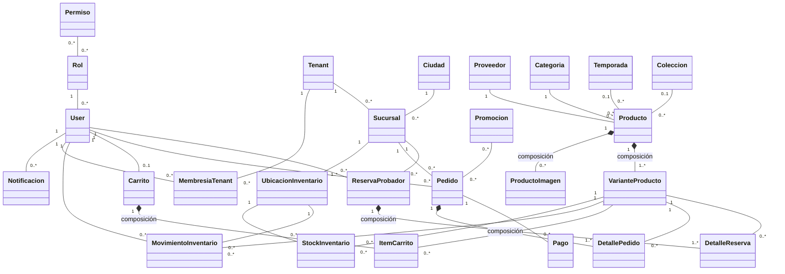

# CAPÍTULO III: DISEÑO Y MODELADO ORIENTADO A OBJETOS

# 3.3. MODELO DE DOMINIO Y 3.4. DIAGRAMA DE CLASES (UML 2.5.1)

> **Proyecto:** FashionStore — Plataforma Inteligente de Comercio Electrónico Omnicanal SaaS Multitenant  
> **Estándar Oficial:** OMG Unified Modeling Language (OMG UML) Versión 2.5.1 (`formal/17-12-05`)  
> **Herramienta Destino:** Sparx Systems Enterprise Architect (XMI 2.1)  
> **Archivos Generados:**  
> - `docs/3.3_modelo_de_dominio_fashionstore.xmi` (Modelo de Dominio Conceptual: solo nombres de entidades)  
> - `docs/3.4_diagrama_de_clases_fashionstore.xmi` (Diagrama de Clases: nombres de atributos limpios sin tipos de datos, relaciones y cardinalidades)  

---

## 1. GUÍA RÁPIDA: IMPORTACIÓN EN ENTERPRISE ARCHITECT

Para importar cualquiera de los dos modelos en **Sparx Systems Enterprise Architect** (versiones 12, 13, 14, 15, 16 o 17):

1. **Abrir o crear un proyecto** en Enterprise Architect (`.eap`, `.eapx` o `.qea`).
2. En la ventana **Browser / Project Browser**, seleccionar el paquete raíz o vista donde se desea alojar el modelo (por ejemplo, `Model`, `Logical View` o un paquete creado como `Modelo-dominio`).
3. Acceder al diálogo de importación XMI:
   - **Menú Ribbon:** Ir a la pestaña **Publish** (o **Specialize**) ➔ Sección **Model Exchange** ➔ Clic en **Import XML** ➔ Seleccionar **Import Package from XMI...**
   - **Atajo de teclado:** Presionar `Ctrl + Alt + I`.
4. En el campo **Filename**, hacer clic en `Browse...` y seleccionar el archivo deseado:
   - Para el Modelo de Dominio: `docs/3.3_modelo_de_dominio_fashionstore.xmi`
   - Para el Diagrama de Clases Limpio: `docs/3.4_diagrama_de_clases_fashionstore.xmi`
5. En las opciones de importación:
   - Marcar **Import Diagrams**.
   - Dejar las opciones predeterminadas (XMI 2.1 / Automatic Merge).
6. Presionar **Import**.
7. En el árbol del explorador de proyectos aparecerá el paquete importado. Al desplegarlo y hacer **doble clic en el diagrama**, se visualizarán todos los elementos organizados con sus relaciones, multiplicidades y composiciones de rombo negro.

---

## 2. SECCIÓN 3.3: MODELO DE DOMINIO (CONCEPTUAL)

Captura las **entidades esenciales del negocio** del mundo real sin atributos ni métodos, idéntico a la estructura de la imagen de referencia:

---

## 3. SECCIÓN 3.4: DIAGRAMA DE CLASES (LIMPIO: ATRIBUTOS SIN TIPO, RELACIONES Y CARDINALIDADES)

### 3.1. Enfoque Visual Limpio
El diagrama se enfoca exclusivamente en:
1. **Atributos de Datos (sin tipos ni métodos):** Lista clara y directa de los campos de negocio que posee cada clase.
2. **Relaciones Estructurales:** Asociaciones binarias con roles y sentidos navegables.
3. **Cardinalidades / Multiplicidades:** Indicación precisa de los rangos numéricos de participación (`1`, `0..*`, `1..*`, `0..1`).
4. **Composición de Agregación Binaria (`◆`):** Rombos negros de pertenencia existencial.

### 3.2. Catálogo de Clases y Atributos

* **User**: `id`, `email`, `passwordHash`, `firstName`, `lastName`, `phone`, `isActive`, `isWholesaler`, `preferences`, `createdAt`, `updatedAt`
* **Role**: `id`, `name`, `description`
* **Permission**: `id`, `code`, `description`
* **Tenant**: `id`, `name`, `slug`, `schemaName`, `plan`, `status`, `ownerName`, `ownerEmail`, `phone`, `customDomain`, `logoUrl`, `primaryColor`, `settings`, `createdAt`, `updatedAt`
* **TenantMembership**: `id`, `tenantId`, `userId`, `role`, `createdAt`, `updatedAt`
* **Notification**: `id`, `userId`, `title`, `message`, `type`, `isRead`, `createdAt`
* **City**: `id`, `name`, `createdAt`
* **Branch**: `id`, `cityId`, `name`, `address`, `phone`, `isActive`, `createdAt`, `updatedAt`
* **InventoryLocation**: `id`, `branchId`, `name`, `type`, `createdAt`
* **InventoryStock**: `id`, `variantId`, `locationId`, `quantity`, `minStock`, `updatedAt`
* **InventoryMovement**: `id`, `variantId`, `locationId`, `userId`, `type`, `quantity`, `previousStock`, `newStock`, `reference`, `notes`, `createdAt`
* **Supplier**: `id`, `name`, `contactEmail`, `phone`, `address`
* **Category**: `id`, `name`, `slug`
* **Season**: `id`, `name`, `startDate`, `endDate`
* **Collection**: `id`, `name`, `description`
* **Product**: `id`, `name`, `description`, `brand`, `categoryId`, `seasonId`, `collectionId`, `supplierId`, `arImageUrl`, `isActive`, `createdAt`, `updatedAt`
* **ProductVariant**: `id`, `productId`, `sku`, `barcode`, `color`, `size`, `price`, `cost`, `isActive`, `createdAt`, `updatedAt`
* **ProductImage**: `id`, `productId`, `url`, `isCover`, `sortOrder`
* **Cart**: `id`, `userId`, `createdAt`, `updatedAt`
* **CartItem**: `id`, `cartId`, `variantId`, `quantity`, `createdAt`
* **Order**: `id`, `userId`, `branchId`, `type`, `status`, `total`, `idempotencyKey`, `createdAt`
* **OrderItem**: `id`, `orderId`, `variantId`, `quantity`, `unitPrice`
* **Payment**: `id`, `orderId`, `method`, `status`, `amount`, `transactionRef`, `createdAt`
* **Reservation**: `id`, `userId`, `branchId`, `status`, `approxTime`, `expiresAt`, `createdAt`, `updatedAt`
* **ReservationItem**: `id`, `reservationId`, `variantId`, `quantity`, `notes`
* **Promotion**: `id`, `name`, `code`, `description`, `discountPercent`, `minPurchaseAmount`, `startDate`, `endDate`, `isActive`, `createdAt`, `updatedAt`
